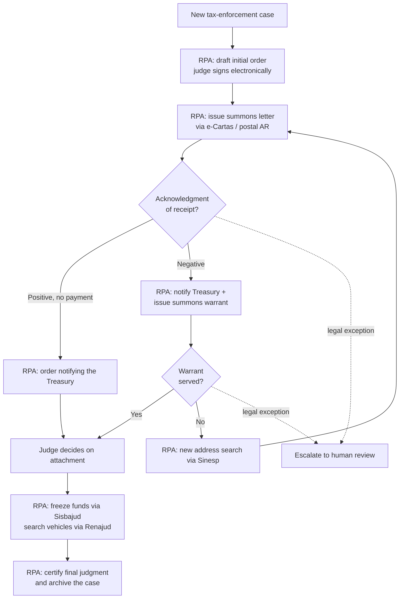

# Robô Clóvis — Legal Architecture for Judicial Process Automation

> **Case study** · Legal Process Automation · Legal Engineering · RPA in a regulated environment
> 1st Justice 4.0 Center – Tax Enforcement · Court of Justice of the State of Ceará (TJCE), Brazil · 2022–2026


**TL;DR** — Robô Clóvis is a set of integrated robots that carries a tax-enforcement case from the initial order all the way to archiving, without automating any decision that requires a judge. I designed the **legal logic** behind it. That meant translating Brazilian civil and tax procedure into step-by-step rules, setting the escalation criteria for when a case needs a human, and defining the legal parameters for queries to federal asset databases. A software team turned those rules into code. In 2025 the unit recorded **68,187 procedural movements** and reached **245% of the national case-judgment goal**. In 2024 the project was approved as a **National Best Practice** by Brazil's leading civil-procedure forum.

> ℹ️ This repository holds a case study, not source code. Clóvis belongs to TJCE. All figures come from the public sources listed under [Sources](#sources).

---

## 1. The Problem

Tax-enforcement cases (*execuções fiscais*) are among the largest dockets in the Brazilian judiciary. Most of the work is repetitive and rule-based:

- **The same steps over and over:** issue the initial order, send a summons letter, notify the Treasury, search for assets, certify the final judgment, archive.
- **Each step has legal consequences.** One wrong summons can void the whole proceeding. A typical corporate bot can undo a mistake; a court bot often can't.
- **Thousands of cases at different stages**, spread across dozens of judicial districts and handled by a small team.

The question was not *"can we write a bot?"* It was **"which acts can a robot legally perform, under what conditions, and where must a human take over?"**

## 2. My Role: Legal Architect of the Automation

**Director of Secretariat & Chambers**, 1st Justice 4.0 Center – Tax Enforcement (TJCE), April 2022 – May 2026.

The project had two separate workstreams. The development team built the software, the infrastructure and the integrations. I owned the legal side:

| I owned | What it involved |
|---|---|
| **Automation discovery** | Found the procedural flows with the highest automation potential |
| **Legal-to-logic mapping** | Translated the Code of Civil Procedure and the Tax Enforcement Act (Law 6,830/1980) into conditional, step-by-step specifications |
| **Exception & escalation protocol** | Defined when a case must leave the automated flow for human review: the line between automatable and judicial judgment |
| **Legal framework for federal integrations** | Set what data could be queried in Sisbajud (asset freezing) and Renajud (vehicle search), under which legal conditions and with what procedural effect |
| **Legal validation & sign-off** | Validated every automated routine before deployment so the supervising judge could authorize it |
| **Robot ownership** | Named *main contact / responsible party* for robots in TJCE's official robot catalog, the Digital Hub (e.g., **RPA008 – Summons Letter** and **RPA009 – Initial Order**) |

**What I didn't do:** write the code. Developers built the robots; I decided *what they should do, when, and within what legal limits*.

## 3. The Solution

Clóvis is an **assisted RPA** system: a person starts each run, and the robots then run inside the court's case-management platform (PJe). Judicial decisions stay with judges. The robots draft and route, and the judge signs.

### End-to-end flow

Based on the official description in FPPC Good Practice No. 25:



### Example: how a legal rule becomes a robot spec

Every robot starts with a **step-by-step specification**: the exact sequence of screens, fields and templates the robot follows, written so that each output is legally valid. Here is an abridged version of RPA008 (*Drafting a Summons Letter in PJe*):

```text
TRIGGER   Cases labeled "1. Awaiting Issuance of Summons Letters"
          in task [EF] Prepare Communications
STEPS     Select defendant → Communication: Summons → Method: Mail
          → Deadline: 5 days → defendant's first registered address
          → Template: ECARTAS_SUMMONS LETTER_NUCLEUS 40
          → Sign digitally → Send e-letter WITH acknowledgment of receipt
RESULT    Case moves to "Await postal service response"
LOOP      Repeat for every case carrying the label
```

The template, the deadline, the method and the order of the steps are legal choices, not technical ones. Get one wrong and the summons is void.

## 4. Results

**Early impact: the first six robots** (May–Dec 2023)
- **18,562 cases** moved on PJe: **8,928** summons letters and **9,634** judicial acts drafted
- The initial-order robot does in **~30 seconds** a task that used to take a clerk much longer
- The summons robot alone has since produced **16,000+ letters** over **295+ hours** of robot runtime, according to the TJCE development team

**Unit productivity in 2025** (1st Justice 4.0 Center – Tax Enforcement)

| Metric | 2025 |
|---|---|
| Procedural movements | **68,187** |
| Orders issued | **44,783** |
| Judgments | **12,406** |
| Decisions | **10,998** |
| Citation letters on a typical day | **~800** |

**National targets (CNJ goals, 2025)**

| CNJ Goal | Achievement |
|---|---|
| Goal 1: judge more cases than were filed | **245.45%** |
| Goal 2: resolve the oldest cases | **100.9%** |
| Goal 5: reduce congestion rate | **132.99%** |

**Speed:** average time to judgment fell from **37 to 20 months** in a little over a year (Grupo Portfolio, TJCE's project consultancy).

**Recognition and reach**
- 🏆 **National Best Practice No. 25**, Permanent Forum of Civil Procedure Specialists (FPPC), Brasília, March 2024. Approved unanimously by the plenary of ~500 procedural specialists. Clóvis and the Federal Supreme Court's *VitórIA* were the two tools recognized out of 20+ reviewed.
- 📈 **Model expanded:** the Center's coverage grew from the pilot to dozens of judicial districts. In October 2024, TJCE's Full Court approved four new Justice 4.0 Centers based on its results.
- 🤝 **Shared beyond Ceará:** under a cooperation agreement, the Court of Justice of Minas Gerais (TJMG) adopted robots developed at TJCE.
- 🗞️ Featured in *Portal Carreira Jurídica* (Feb 2026): *"Layla Viana shows how robotization increased productivity at the Justice 4.0 Center in Ceará."*

## 5. What I Learned

1. **In legal automation, the hard part is the law, not the code.** Each robot is only as reliable as the legal specification behind it.
2. **Design the exceptions first.** Deciding what the robot must *not* do is the most legally sensitive part of the system.
3. **Keep judges in the loop by design.** Assisted automation, with human triggers and judicial signatures, is what made adoption possible inside a court.
4. *"Automating means rethinking workflows, identifying bottlenecks and adjusting processes to the reality of the unit. Without this, technology cannot deliver its full potential."* That's how I put it in the Feb 2026 interview.

## 6. Why It Transfers

The method I used doesn't depend on Brazilian law. It works for **any rules-heavy legal workflow**, from immigration petitions and compliance checks to contract operations and claims processing:

`regulation → decision logic → robot spec → exception protocol → human sign-off → measurable output`

**Skills:** `Legal Engineering` · `Legal Process Automation` · `RPA` · `Requirements & Process Mapping` · `Exception Design / Human-in-the-loop` · `Regulatory Compliance` · `Legal Operations` · `Change Management`

---

## Sources

- TJCE — [Robotization boosts productivity at the Justice 4.0 Center – Tax Enforcement](https://www.tjce.jus.br/noticias/robotizacao-contribui-com-a-produtividade-do-nucleo-de-justica-4-0-execucoes-fiscais/) (Jan 2026)
- TJCE — [Robô Clóvis recognized as a Best Practice by the Permanent Forum of Civil Proceduralists](https://www.tjce.jus.br/noticias/robo-clovis-do-tjce-e-reconhecido-como-boa-pratica-no-forum-permanente-de-processualistas-civis/) (Mar 2024)
- FPPC — *Brasília Charter*, XIII Permanent Forum of Civil Procedure Specialists, Good Practice No. 25 (Mar 2024)
- Migalhas — [Robots implemented at TJ/CE have already moved more than 18,000 cases](https://www.migalhas.com.br/quentes/397947/robos-implementados-no-tj-ce-ja-movimentaram-mais-de-18-mil-processos) (Dec 2023)
- Grupo Portfolio — [Grupo Portfolio contributed to the Clóvis robot development project](https://blog.grupoportfolio.com.br/blog/2024/12/27/grupo-portfolio-contribuiu-para-projeto-de-desenvolvimento-do-robo-clovis/) (Dec 2024)
- Portal Carreira Jurídica — [Layla Viana shows how robotization increased productivity at the Justice 4.0 Center in Ceará](https://portalcarreirajuridica.com.br/layla-viana-mostra-como-a-robotizacao-elevou-a-produtividade-do-nucleo-de-justica-4-0-no-ceara/) (Feb 2026)
- TJCE — [Digital Hub robot catalog](https://transformacaodigital.tjce.jus.br/hub-digital/) (RPA008, RPA009; internal VPN required for manuals)

---

**Layla Viana** · Legal Process Automation · [LinkedIn](https://www.linkedin.com/in/laylavianacruz) · [GitHub](https://github.com/laylavianacruz)
